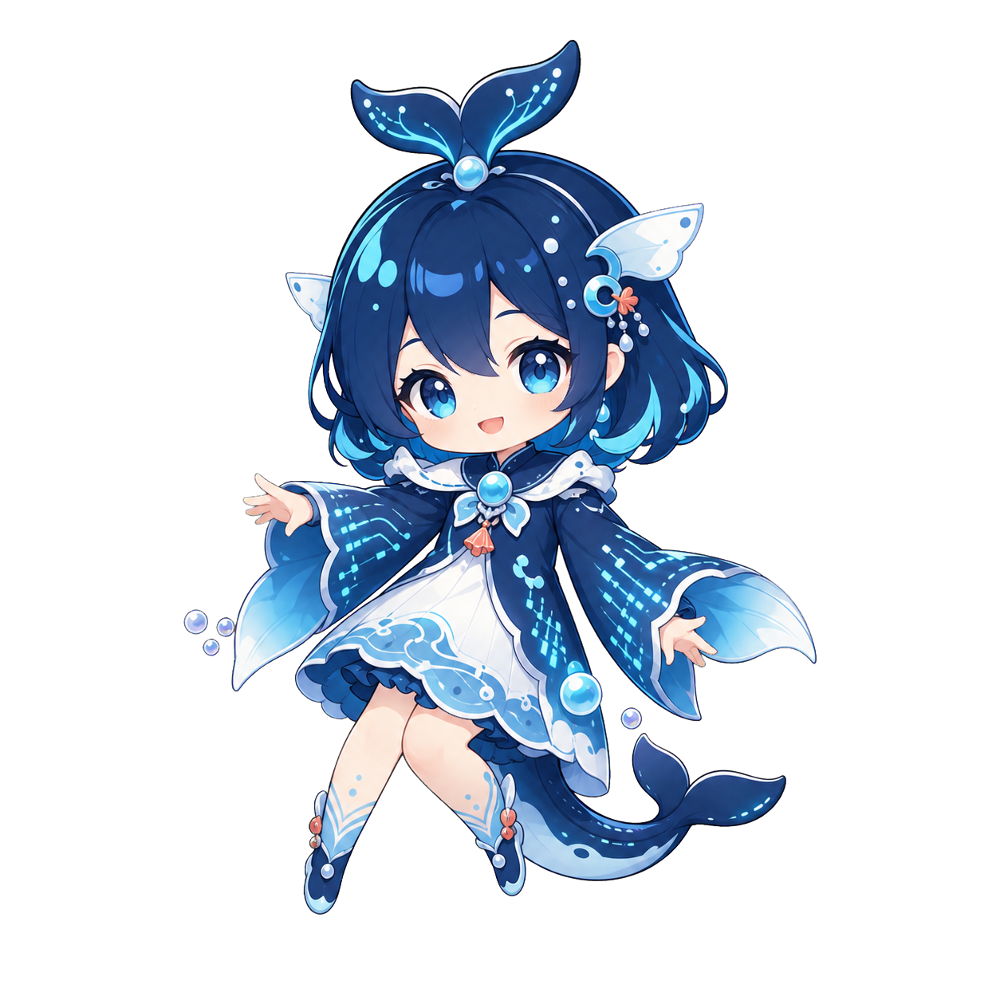
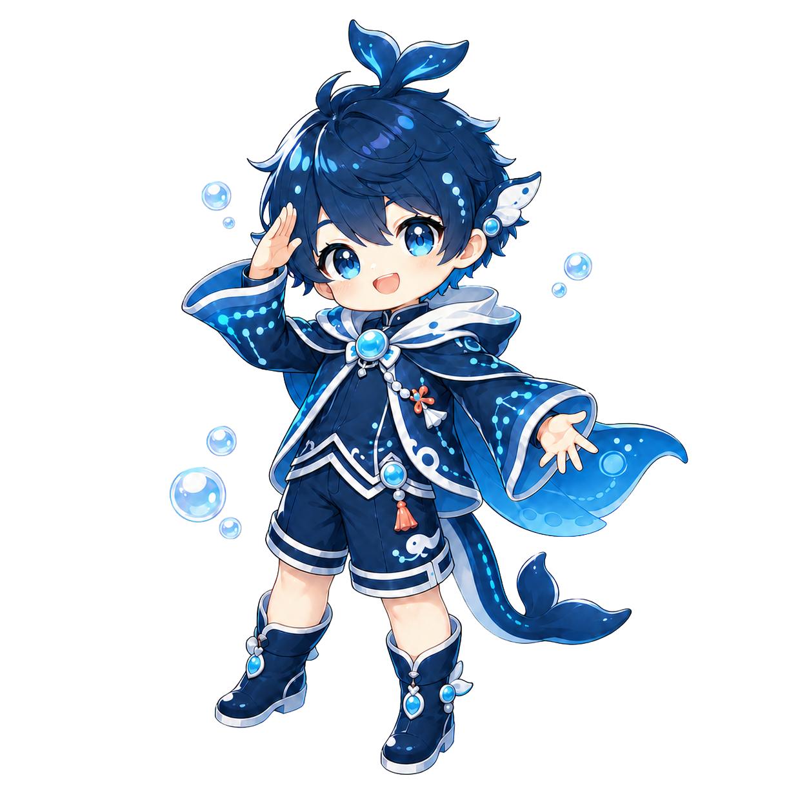

# 深海鲸灵 · Windows 桌宠

一个原创的“深海鲸灵”桌面宠物原型，内置鲸鱼少女与鲸鱼少年两位主角。它采用 Electron + React + TypeScript 构建，支持透明置顶窗口、拖拽、点击反馈、聊天、专注计时、设置持久化和系统托盘。

> 这是非官方同人概念原型，与 DeepSeek 官方无隶属、授权或背书关系。项目没有使用 DeepSeek Logo、官方角色素材或复制的品牌视觉。


**DeepSea Whale Pet** is a Windows desktop companion built with Electron, React and TypeScript. It offers animated characters, local preset replies, optional OpenAI-compatible chat, focus sessions, weather reactions and configurable daily routines. Maintained by [zqc1222](https://github.com/zqc1222).

[下载 Windows 版本](https://github.com/zqc1222/deep-sea-whale-pet/releases/latest) · [反馈问题](https://github.com/zqc1222/deep-sea-whale-pet/issues) · [参与维护](CONTRIBUTING.md) · [许可范围](docs/LICENSING.md)

## 安装与开始使用

适用于 Windows 10/11 x64。普通用户无需安装 Node.js：从 Releases 下载 `Setup` 安装版或 `Portable` 便携版，按[核验指南](docs/VERIFY-DOWNLOAD.md)检查后运行。

首次使用可直接选择本地陪伴模式，其回复由内置规则与文案提供，不运行本地大模型。需要模型对话时，在设置里切换 API 模式并填写自己的服务地址、模型和密钥；费用与数据处理方式取决于所选服务。

适合想在桌面获得轻量互动、使用 25 分钟专注计时或配置作息提醒的用户。使用人数及用户反馈尚未整理，项目不据此宣称广泛采用或特定效果。

## 角色预览

以下为项目角色素材预览，不是软件运行截图。

| 鲸鱼少女 | 鲸鱼少年 |
| --- | --- |
|  |  |

## 已实现

- 透明、无边框、始终置顶的桌宠窗口
- 鼠标拖拽与多显示器工作区边界保护，位置自动保存
- 透明空白区域动态点击穿透，不挡住后面的桌面图标与窗口
- 待机持续漂浮与呼吸、动态阴影、多节奏气泡、随机眨眼和偶发轻微偏头
- 保留主立绘，并随机切换“想吃白饭、趴睡、认真思考、任务板工作”四种性格状态
- 设置页可在鲸鱼少女与鲸鱼少年之间切换；两位角色各自拥有待机、饿了、困倦、思考和工作五套完整素材
- 每次进入新状态时自动显示贴合情境的随机短句，并用状态标签和颜色区分饭点、休眠、思考与专注
- 聊天时显示思考形态，进入专注面板时显示任务板工作形态
- 长对话使用独立消息滚动区，输入框、底部导航和左侧角色始终留在窗口内
- 右侧快捷栏平时自动隐藏，靠近角色时浮现；星光按钮可手动轮播状态
- 点击开心、连续点击晕乎、拖拽和专注完成庆祝状态
- 单击随机气泡、双击聊天、右键原生菜单
- 本地陪伴聊天，无需密钥即可体验
- OpenAI-compatible 模型适配器
- 设置页可在本地陪伴与 API 模式之间显式切换，切回本地不会删除已加密的模型配置
- 桌宠大小支持输入 50%–200% 的任意整数比例，并提供常用尺寸快捷值
- 25 分钟专注计时
- 音效、减少动画、开机启动与自定义缩放
- Windows 系统托盘：显示/隐藏、聊天、专注、设置、退出
- 浏览器演示模式，方便不启动 Electron 时检查界面与交互
- 设置页新增「打赏作者」区块：展示收款码，并提示打赏完全自愿、理性消费、量力而行
- 天气感知：右上角显示温度徽章，每种天气专属随机语音，天气持续期间也会隔段时间冒一句
- 设置页提供应用文件短指纹，辅助对比构建内容；下载来源及完整性应按[核验指南](docs/VERIFY-DOWNLOAD.md)独立检查

## 开发运行

环境建议：Node.js 22+，Windows 10/11。

```powershell
npm ci
npm run dev
```

常用操作：

- 单击角色：随机气泡互动
- 双击角色：打开聊天面板
- 拖动角色：移动到桌面任意位置
- 右键角色：打开功能菜单
- 靠近角色：显示右侧快捷栏；点击星光按钮轮播状态
- 托盘图标：显示或隐藏桌宠

## 浏览器演示

浏览器模式会模拟桌面背景和主要交互，但不会连接外部模型，也不会保存 API Key。

```powershell
npm run demo
```

然后打开终端显示的本地地址，默认通常是 `http://127.0.0.1:5173`。

## 检查与构建

```powershell
# TypeScript 严格检查
npm run typecheck

# 构建 Electron 主进程、预加载和渲染页面
npm run build

# 生成 Windows NSIS 安装包与 portable 版本
npm run package
```

打包产物默认写入 `dist/`。

当前输出：

- `DeepSeaWhalePet-Setup-0.7.2-x64.exe`：可选择安装目录的 Windows 安装版
- `DeepSeaWhalePet-Portable-0.7.2-x64.exe`：无需安装的便携版

项目没有配置商业代码签名证书，因此 Windows SmartScreen 可能显示“未知发布者”。请按[下载核验指南](docs/VERIFY-DOWNLOAD.md)检查完整文件 Hash。应用内短指纹不能替代发布者签名验证。

默认 `npm run package` 使用镜像下载 Electron 打包组件；网络可直接访问官方 GitHub Releases 时，也可以使用 `npm run package:direct`。

## 模型设置与安全

设置页接受 OpenAI-compatible 的 Base URL、模型名和 API Key。

- 渲染页面通过白名单 preload API 与主进程通信。
- `contextIsolation` 已开启，`nodeIntegration` 已关闭，sandbox 已开启。
- API Key 不会返回给渲染页面，不会写进项目仓库，也不会输出到日志。
- 在 Electron 模式下，Key 使用系统 `safeStorage` 加密后保存在应用数据目录。
- 所有模型请求都由主进程发出，并设有消息长度、数量和响应超时限制。

建议把 Base URL 填到版本级路径，例如：

```text
https://api.example.com/v1
```

程序会自动补上 `/chat/completions`。

## 目录

```text
src/
  main/          Electron 主进程、窗口、托盘、安全存储、模型请求
  preload/       contextBridge 白名单 API
  renderer/      React 界面、动画、聊天、计时与设置
  shared/        主进程和渲染进程共享类型
work/imagegen/   角色素材的抠图中间文件（被 gitignore 忽略）
docs/            角色素材来源与生成说明
```

## 替换角色素材

女主待机素材为 `src/renderer/assets/whale-girl.png`，男主待机素材为 `src/renderer/assets/whale-boy.png`。女主状态素材位于 `src/renderer/assets/states/`，男主状态素材位于 `src/renderer/assets/states/boy/`。

替换时建议保留：

- 正方形透明 PNG 或 WebP
- 角色完整、四周有留白
- 主体颜色避免与桌面常见背景完全融在一起
- 文件名保持不变，或同步修改 `src/renderer/src/App.tsx` 的导入路径

## 设计方向

界面采用“深海观测站里的小精灵”概念：深海蓝为主体，青色声呐线和珊瑚色小点作强调；面板使用不规则圆角、细网格与数据深度刻度，避免常见的通用 SaaS 卡片风格。

## 数据与隐私

- 设置、窗口位置及羁绊记录保存在本机；API Key 由系统安全存储能力加密。
- API 模式会将对话发送给你配置的模型服务；本地陪伴模式不发送模型请求。
- 开启天气后，会向天气服务请求城市或经纬度对应的天气。
- 主动关怀读取前台窗口标题和空闲时长用于本地分类，不通过该功能上传窗口标题；可在设置里关闭。
- 反馈时不要附带密钥、私人聊天或含个人信息的窗口标题。

## 版本与维护

历史发布见 [Releases](https://github.com/zqc1222/deep-sea-whale-pet/releases)，源码修改见[提交记录](https://github.com/zqc1222/deep-sea-whale-pet/commits/main/)。各版本说明保存在 `docs/release-*.md`。历史版本中记录的验证结果不代表当前源码已重新通过同样的检查。

主要维护者为 [zqc1222](https://github.com/zqc1222)，问题和建议请通过 [Issues](https://github.com/zqc1222/deep-sea-whale-pet/issues) 提交。使用情况与反馈的待补材料见[证据整理表](docs/MAINTAINER-EVIDENCE.md)。

## 许可证

代码与文档采用 [MIT](LICENSE)。原创角色素材的授权范围、收款码例外以及第三方组件说明见[许可说明](docs/LICENSING.md)，素材生成记录见[ASSET-NOTES](docs/ASSET-NOTES.md)。`package.json` 中的 `private: true` 用于防止误发布到 npm，不表示 GitHub 仓库私有。
